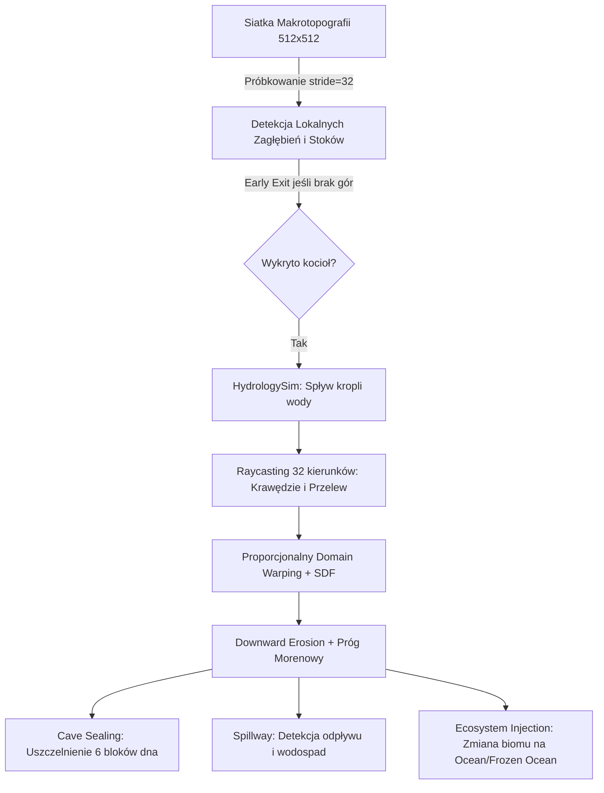
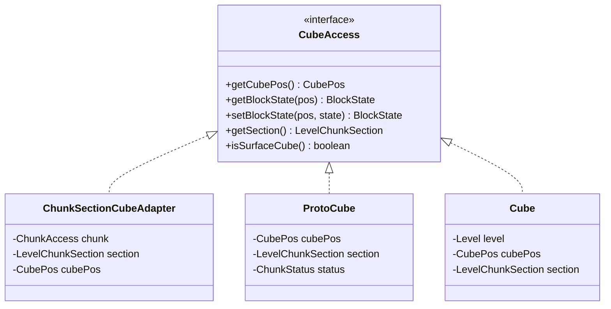

# 🌊 Outflow — Zaawansowany Silnik Hydrologiczny i Geologiczny dla Minecrafta

[](https://fabricmc.net/)
[](https://fabricmc.net/)
[](https://modrinth.com/mod/lithostitched)
[](https://www.oracle.com/java/)
[]()
[](LICENSE_outflow)

> **Outflow** to wysokowydajny mod dla platformy **Fabric (Minecraft 26.2 / Java 25)**, zastępujący waniliowe, nienaturalne generowanie wody realistyczną symulacją hydrologiczną i geomorfologiczną. Mod wprowadza do gry naturalne stawy wysokogórskie (Alpine Tarns), spływy i kaskady wodne (Waterfalls), wulkaniczne kaldery (Calderas), laguny lodowcowe (Glacier Lakes), spękaną krę lodową (Worley Ice Floes) oraz uwarstwione urwiska skalne (Cliff Faces) — w oparciu o pola odległości (SDF), wielowątkowe algorytmy spływu grawitacyjnego, architekturę podsektorów 3D (Cubic Chunks) oraz data-driven system modyfikatorów **Lithostitched**.

---

## 📑 Spis Treści

1. [Geneza i Wizja Projektu](#-geneza-i-wizja-projektu)
2. [Kluczowe Moduły i Funkcje](#-kluczowe-moduły-i-funkcje)
   - [1. Alpine Tarns (Jeziora Cyrkowe / Stawy Polodowcowe)](#1-alpine-tarns-stawy-wysokogórskie-i-jeziora-cyrkowe)
   - [2. Waterfalls & Cascades (Wodospady i Koryta Spływowe)](#2-waterfalls--cascades-wodospady-i-kaskady-górskie)
   - [3. Calderas & Volcanic Basins (Kaldery Wulkaniczne)](#3-calderas--volcanic-basins-kaldery-wulkaniczne-i-zapadliska)
   - [4. Glacier Lakes (Laguny i Języki Lodowcowe)](#4-glacier-lakes-laguny-i-języki-lodowcowe)
   - [5. Cliff Face & Steep Slopes (Urwiska Skalne i Stratyfikacja Bandlands)](#5-cliff-face--steep-slopes-geologiczne-ściany-skalne)
   - [6. Worley Ice Floes (Realistyczna Kra Lodowa)](#6-worley-ice-floes-popękana-kra-lodowa)
   - [7. Integracja z Lithostitched i Oczyszczanie Waniliowych Źródeł](#7-integracja-z-lithostitched-i-oczyszczanie-zanieczyszczeń-waniliowych)
3. [Architektura Techniczna i Algorytmy](#-architektura-techniczna-i-algorytmy)
   - [Matematyka SDF i Morfologia Terenu](#matematyka-sdf-i-morfologia-terenu)
   - [Symulacja Hydrologiczna (HydrologySim)](#symulacja-hydrologiczna-hydrologysim)
   - [Wielowątkowość i Prefetching (NoiseCache)](#wielowątkowość-i-prefetching-noisecache)
   - [Architektura Wolumetryczna (Cubic Chunks / Sub-chunks 3D)](#architektura-wolumetryczna-cubic-chunks--sub-chunks-3d)
4. [Integracja z Klientem i Interfejs Użytkownika](#-integracja-z-klientem-i-interfejs-użytkownika)
5. [Struktura Projektu i Pakiety](#-struktura-projektu-i-pakiety)
6. [Wymagania i Kompilacja](#-wymagania-i-kompilacja)
7. [Licencja](#-licencja)

---

## 🎯 Geneza i Wizja Projektu

W waniliowym silniku Minecrafta system generowania wody w górach od lat boryka się z rażącymi mankamentami wizualnymi i logicznymi:
* **„Lewitujące” źródła**: Losowe pojedyncze klocki źródła wody (`minecraft:spring_water`) wybijające w środku pionowych ścian i tworzące brzydkie, cienkie strumienie spływające chaotycznie po stokach.
* **Brak prawdziwych jezior górskich**: Woda pojawia się głównie na poziomie morza (`Y=63`) lub w postaci losowych kałuż na szczytach.
* **Dziurawe dna**: Wodne zbiorniki generujące się nad jaskiniami często przebijają ich stropy, tworząc nieskończone, nienaturalne zacieki do podziemi.
* **Trawiaste i śnieżne pionowe ściany**: Niemożliwie strome, 90-stopniowe urwiska górskie pokryte cienką warstwą trawy lub sypkiego śniegu zamiast surowej, litej skały.

**Outflow** rozwiązuje te problemy kompleksowo. Wykorzystując zasady geomorfologii i modelowania matematycznego, mod sprawia, że woda gromadzi się tam, gdzie dyktują to prawa grawitacji — w kotłach lodowcowych, dolinach zawieszonych i misach kraterowych, a jej odpływy tworzą malownicze kaskady spływające po zboczach.

---

## 🏔️ Kluczowe Moduły i Funkcje

### 1. Alpine Tarns (Stawy Wysokogórskie i Jeziora Cyrkowe)
Główny filar moda. Tworzy naturalne zbiorniki wodne u podnóża turni, szczytów i w polodowcowych cyrkach górskich.



* **Zrównoleglone skanowanie regionalne**: Świat podzielony jest na komórki o rozmiarze 512×512 bloków (`gridSize = 512`). Próbkowanie zgrubne (krok 32 bloki) analizuje makrotopografię na wszystkich rdzeniach procesora (`parallelStream`), błyskawicznie odrzucając płaskie niziny.
* **Symulacja spływu kropli (`simulateWaterDrop`)**: Wykryty punkt startowy spływa grawitacyjnie wzdłuż wektorów największego spadku, aż dotrze do rzeczywistego dna kotliny.
* **Raymarching promienisty (32 kierunki)**: Z centrum stawu wyprowadzane są 32 promienie co 11.25°, mierzące odległość do ścian wznoszących się gór lub progu doliny.
* **Proporcjonalny Domain Warping & Signed Distance Field (SDF)**: Brzegi jeziora są zniekształcane harmonicznymi falami sinusoidalnymi (`Math.sin`, `Math.cos`) skalowanymi proporcjonalnie do promienia niecki, tworząc naturalne zatoczki i półwyspy bez wypychania wody poza obrys kotliny.
* **Jeziora paciorkowe (Paternoster Lakes & Multi-Lobe)**: Jeśli w jednej dolinie wygenerują się dwa stawy o zbliżonym poziomie zwierciadła wody, zostają one połączone za pomocą wielomianowego gładkiego minimum (`SDFUtils.smin`), tworząc wielokomorowe akweny o wspólnej tafli.
* **Erozja w dół i ryglowanie progu morenowego**: Jezioro powstaje przez zalewanie i wygładzanie niecki w istniejącej masie skalnej, a ewentualne drobne obniżenia na obrzeżu są zamykane naturalnym wałem morenowym ze skały i żwiru.
* **Batymetria i strefy denne (`getLakePaintState`)**:
  * *Płycizna (0–2 bloki głębokości)*: Piasek z domieszką żwiru.
  * *Średnia głębokość (3–6 bloków)*: Żwir, glina (`clay`) oraz kamień.
  * *Głębia (7–12 bloków)*: Zbita glina i kamień.
  * *Otchłań (>12 bloków)*: Lity kamień lub łupek głębinowy (`deepslate`).
* **Hermetyzacja dna (Cave Sealing)**: Pod dnem jeziora tworzona jest szczelna, 6-blokowa warstwa gliny, kamienia i ziemi, dzięki czemu woda nie przebija się do podziemnych jaskiń.
* **Iniekcja ekosystemu**: Woda stawu otrzymuje odpowiedni biom wodny w kontenerze palety sekcji (`ocean`, `frozen_ocean` lub `lukewarm_ocean` w zależności od temperatury otoczenia). Na płyciznach pojawia się sukcesja roślinna (lilie wodne, trawa morska).
* **Zlodowacenie brzegowe**: W niskich temperaturach (`< 0.15`) tafla wody zamarza w lód z językami szumu lodowego ku środkowi jeziora.

---

### 2. Waterfalls & Cascades (Wodospady i Kaskady Górskie)
Zamiast statycznej tafli, woda w jeziorze górskim znajduje swój naturalny punkt ucieczki.

* **Detekcja progu przelewowego (Spillway)**: Promień o największym spadku terenu na zewnątrz misy jeziora wyznacza naturalne koryto odpływowe.
* **Trasowanie strugi wody (`placeWaterfallFromLake`)**: Woda z przelewu wypływa na zewnątrz jeziora i podąża za wektorem największego spadku terenu, rzeźbiąc koryto potoku oraz progi kaskadowe.
* **Trzy typy kaskad**:
  1. `SINGLE_COLUMN`: Wąski potok i wodospad na mniejszych progach skalnych.
  2. `DOUBLE_CASCADE`: Złożony, dwustopniowy wodospad dla spadków terenu powyżej 12 bloków.
  3. `WIDE_CURTAIN`: Szeroka kurtyna wodna dla dużych przelewów.
* **Kotły eworsyjne (Plunge Pools)**: W miejscu uderzenia wodospadu w dno doliny powstaje naturalny kocioł wypełniony wodą, wyłożony mszystym brukiem (`mossy_cobblestone`), brukiem i żwirem.

---

### 3. Calderas & Volcanic Basins (Kaldery Wulkaniczne i Zapadliska)
Monumentalne formacje wulkaniczne o promieniu 26–44 bloków generujące się w wysokich partiach gór (`Y >= 95`).

* **Dwa typy genezy**:
  * *Zapadlisko szczytowe (Peak Collapse)*: Wierzchołek wysokiej góry ulega zapadnięciu o 14–26 bloków w głąb masywu, tworząc amfiteatralny krater otoczony koroną tufowo-bazaltową.
  * *Kocioł kraterowy (Basin Crater)*: Wysokogórska niecka wulkaniczna otoczona wieńcem stromych ścian.
* **Dynamika wypełnienia**: 65% kalder jest wypełnionych wodą poniżej najniższego punktu korony krateru, tworząc głębokie jeziora kraterowe; 35% to suche, dymiące kotły wulkaniczne.
* **Wulkaniczna geologia dna**:
  * Korona i górne ściany: tuf (`tuff`) oraz bazalt (`basalt`).
  * Środkowe strefy: gładki bazalt (`smooth_basalt`) oraz czernit (`blackstone`).
  * Strefa gorąca i dno komory magmowej: bloki magmy (`magma_block`), obsydian (`obsidian`) oraz płaczący obsydian (`crying_obsidian`).
* **Wzmocnione ryglowanie jaskiń**: Dno kaldery uszczelnia podłoże gładkim bazaltem i łupkiem głębinowym aż do napotkania 3 kolejnych litych bloków (do 16 bloków w głąb).

---

### 4. Glacier Lakes (Laguny i Języki Lodowcowe)
W mroźnych biomach górskich (`#minecraft:is_mountain`, temperatura `<= 0.35`, wysokość `72..230` filtrowana przez `lithostitched:height_filter`) powstają polodowcowe laguny z czołem schodzącego lodowca:
* **Język lodowcowy**: Od strony najwyższego zbocza do wody schodzi masyw zbudowany z niebieskiego lodu (`blue_ice`), zbitego lodu (`packed_ice`) i czapy śnieżnej (`snow_block`).
* **Dryfująca kra**: Na otwartej tafli laguny unoszą się odłamki lodu i paku lodowego.

---

### 5. Cliff Face & Steep Slopes (Geologiczne Ściany Skalne)
Koniec z zieloną trawą i sypkim śniegiem na pionowych przepaściach — system działa dwustopniowo (w fazie `buildSurface` za pośrednictwem **Lithostitched** oraz w fazie `LOCAL_MODIFICATIONS` dla nawisów 3D):

* **Warstwa 1 — Lithostitched `add_surface_rule` + `bandlands` ([`add_cliff_surface_rules.json`](src/main/resources/data/outflow/lithostitched/worldgen_modifier/add_cliff_surface_rules.json))**:
  * Wykorzystuje warunek `lithostitched:slope` (`height_difference: [3, 256]`) oraz wykluczenie `#minecraft:is_badlands` (`lithostitched:biome`), wstrzykując regułę powierzchniową przed waniliowymi regułami.
  * Zamiast trawy i ziemi na stromych stokach generowane są uwarstwione pasma skalne `lithostitched:bandlands` ([`cliff_stratification.json`](src/main/resources/data/outflow/lithostitched/bandlands/cliff_stratification.json)) złożone z kamienia (`stone`), powtarzalnych żył andezytu (`andesite`) i tufu (`tuff`) przesuniętych szumem `bandOffsetNoise`.
* **Warstwa 2 — Korekta 3D i zdzieranie nawisów ([`CliffFacePhase.java`](src/main/java/pl/k8bus/outflow/worldgen/feature/CliffFacePhase.java))**:
  * Oblicza rzeczywisty gradient euklidesowy na buforze 18×18 (z marginesem 1 bloku z sąsiednich chunków):
    $$\text{Gradient} = \sqrt{\left(\frac{\Delta h_x}{2}\right)^2 + \left(\frac{\Delta h_z}{2}\right)^2}$$
  * Zdziera miękką pokrywę (`stripTopsoil`) na krawędziach i skanuje pionowe ściany oraz nawisy skalne 3D (`isExposedOnVerticalWall`), zastępując odsłoniętą ziemię uwarstwioną skałą (`stone`, `andesite`, `tuff` powyżej `Y=0` oraz `deepslate` poniżej `Y=0`).

---

### 6. Worley Ice Floes (Popękana Kra Lodowa)
W chłodnych biomach zamarznięte jeziora i rzeki nie są płaską, jednolitą płytą lodową.

* **Faza `TOP_LAYER_MODIFICATION`**: Cecha uruchamia się po waniliowym zamarzaniu wody (`freeze_top_layer`), dzięki czemu obejmuje zarówno stawy alpejskie Outflow, jak i waniliowe zamarznięte rzeki oraz jeziora.
* **Szum komórkowy Worleya (Cellular/Voronoi)**: Tafla lodu dzielona jest na wielokątne komórki kry (`CELL_SIZE = 6`) przy użyciu deterministycznego haszowania 64-bitowego z seeda świata.
* **Naturalne szczeliny wodne (`CRACK_WIDTH = 0.18`)**: Krawędzie między komórkami Worleya są zastępowane otwartą wodą, tworząc efekt popękanej kry z zachowaniem pasa ochronnego przy samym brzegu (`SHORE_MARGIN = 2`).

---

### 7. Integracja z Lithostitched i Oczyszczanie Zanieczyszczeń Waniliowych
Mod wykorzystuje bibliotekę **[Lithostitched](https://modrinth.com/mod/lithostitched)** (wbudowaną również bezpośrednio w `.jar` metodą Jar-in-Jar) do w pełni data-driven zarządzania modyfikacjami świata w katalogu `data/outflow/lithostitched/worldgen_modifier/`:

* **[`remove_mountain_springs.json`](src/main/resources/data/outflow/lithostitched/worldgen_modifier/remove_mountain_springs.json)**: Za pomocą `lithostitched:remove_features` (`priority: 2000`) usuwa `minecraft:spring_water` z kroku `fluid_springs` we wszystkich biomach `#minecraft:is_mountain`, eliminując lewitujące źródła wody w ścianach górskich.
* **[`add_alpine_tarns.json`](src/main/resources/data/outflow/lithostitched/worldgen_modifier/add_alpine_tarns.json)**: Rejestruje cechy `outflow:alpine_tarn` oraz `outflow:caldera` w kroku `lakes` dla `#minecraft:is_overworld`.
* **[`add_glacier_lakes.json`](src/main/resources/data/outflow/lithostitched/worldgen_modifier/add_glacier_lakes.json)**: Rejestruje `outflow:glacier_lake` w kroku `lakes` dla `#minecraft:is_mountain`.
* **[`add_cliff_faces.json`](src/main/resources/data/outflow/lithostitched/worldgen_modifier/add_cliff_faces.json)** & **[`add_ice_floes.json`](src/main/resources/data/outflow/lithostitched/worldgen_modifier/add_ice_floes.json)**: Rejestrują post-processing urwisk 3D (`local_modifications`) i kry lodowej Worleya (`top_layer_modification`).
* **Pełna kompatybilność z datapackami i modpackami**: Każdy modyfikator Outflow można dostosować lub wyłączyć z poziomu datapacka (np. poprzez `lithostitched:no_op`) bez rekompilacji kodu.

---

## ⚙️ Architektura Techniczna i Algorytmy

### Matematyka SDF i Morfologia Terenu
Klasa [`SDFUtils`](src/main/java/pl/k8bus/outflow/worldgen/math/SDFUtils.java) zawiera rdzenne funkcje modelowania kształtów:

| Funkcja | Równanie matematyczne | Zastosowanie |
|---|---|---|
| `smoothstep(e0, e1, x)` | $t = \text{clamp}\left(\frac{x-e0}{e1-e0}, 0, 1\right); \quad 3t^2 - 2t^3$ | Płynne, nieliniowe przejścia zboczy i brzegów |
| `sdfCircle(dx, dz, r)` | $\sqrt{\Delta x^2 + \Delta z^2} - r$ | Płaskie pole odległości bazy misy jeziora |
| `smin(a, b, k)` | $h = \max(k - \vert a-b \vert, 0)/k; \quad \min(a, b) - \frac{1}{4} h^2 k$ | Wielomianowe stapianie wielu zbiorników wodnych w jeden |
| `sdfMeanderingRiver(...)` | $\vert \Delta z - A \cdot \sin(\Delta x \cdot f) \vert - w$ | Matematyczny profil meandrującego koryta rzeki |

---

### Symulacja Hydrologiczna (HydrologySim)
Klasa [`HydrologySim`](src/main/java/pl/k8bus/outflow/worldgen/math/HydrologySim.java) wykonuje fizyczną symulację zbieżności cieków wodnych:
1. **Faza 1 (Makro)**: Krok próbkowania = 16 bloków (6 iteracji w 8 kierunkach). Szybkie zbieganie w dół doliny.
2. **Faza 2 (Mezo)**: Krok próbkowania = 8 bloków (5 iteracji w 8 kierunkach). Wprowadzanie do zagłębienia.
3. **Faza 3 (Mikro)**: Krok próbkowania = 4 bloki (3 iteracji w 4 kierunkach). Precyzyjne odnalezienie lokalnego minimum (dna niecki).
4. **Walidacja niecki (`isValidBasin`)**: Sprawdza, czy punkt nie jest dnem zbyt wąskiego, nienaturalnego wąwozu.

---

### Wielowątkowość i Prefetching (NoiseCache)
Generowanie zaawansowanej topografii wymaga intensywnego próbkowania generatora szumu Minecrafta. Aby zachować płynność gry:
* **Dedykowana pula `NoiseCache.WORKER_POOL` (`Outflow-LakeGrid-Worker`)**: Obliczenia siatki jezior i kalder wykonywane są asynchronicznie za pośrednictwem `CompletableFuture` na wydzielonej puli wątków, nie blokując `ForkJoinPool.commonPool()` wykorzystywanego wewnętrznie przez `parallelStream()`.
* **Separacja kluczy (`LakeCacheKey`)**: Stawy alpejskie (`"alpine_tarn"`) i kaldery wulkaniczne (`"caldera"`) posiadają niezależne przestrzenie kluczy w pamięci podręcznej regionu.
* **Proaktywny prefetching (`AlpineTarnLocator.prefetchNeighbors`)**: Gdy gracz zbliża się do granicy sektora, Outflow zleca w tle analizę topograficzną dla sąsiednich kratek (Północ, Południe, Wschód, Zachód).
* **Pamięć podręczna wysokości (`HEIGHT_CACHE`)**: Szybki cache `ConcurrentHashMap<Long, Integer>` przechowujący do 65 536 próbek wysokości terenu, zapobiegający powtarzaniu tych samych kalkulacji `getBaseHeight`.

---

### Architektura Wolumetryczna (Cubic Chunks / Sub-chunks 3D)
Pakiet `pl.k8bus.outflow.cubic` to baza pod trójwymiarowe zarządzanie przestrzenią świata:



* **`CubePos`**: 64-bitowa kompresja pozycji kostki 16×16×16 (`asLong()`, `fromLong()`) z podziałem: 22 bity X, 20 bitów Y, 22 bity Z.
* **`ChunkSectionCubeAdapter`**: Most pozwalający traktować standardowe sekcje Minecrafta jako niezależne sześciany 3D.
* **Oznaczanie sekcji powierzchni (`SurfaceSection` & `LevelChunkSectionMixin`)**: `NoiseBasedChunkGeneratorMixin` oznacza sekcje zawierające faktyczną powierzchnię świata oraz sekcję bezpośrednio pod nią.

---

## 🖥️ Integracja z Klientem i Interfejs Użytkownika

Podczas tworzenia nowego świata lub wczytywania wymiaru, Outflow informuje gracza o stanie prac silnika hydrologicznego na ekranie ładowania ([`LevelLoadingScreenMixin`](src/client/java/pl/k8bus/client/mixin/LevelLoadingScreenMixin.java)):

* **Dynamiczny wskaźnik postępu**:
  $$\text{Tytuł: } \text{Outflow Waterworks [X tasks]}$$
* **Animowany kolor wody**: Tytuł mieni się płynną, błękitno-turkusową falą RGB zależną od czasu systemowego:
  $$R = 60 + 20\sin\left(\frac{t}{200}\right), \quad G = 180 + 30\sin\left(\frac{t}{250} + 1\right), \quad B = 230 + 20\sin\left(\frac{t}{300} + 2\right)$$
* **Aktualny stan przetwarzania**:
  * `>> Scanning regional topography... <<`
  * `>> Scanning volcanic topography... <<`
  * `>> Simulating fluid raycasts... <<`
  * `>> Validating basin constraints... <<`

---

## 📂 Struktura Projektu i Pakiety

```text
pl.k8bus/
├── outflow/
│   ├── Outflow.java                      # Główny ModInitializer Fabric
│   ├── cubic/                            # Podsystem silnika wolumetrycznego (3D Sub-chunks)
│   │   ├── math/
│   │   │   └── CubePos.java              # 64-bitowa reprezentacja pozycji kostki 16x16x16
│   │   └── world/
│   │       ├── CubeAccess.java           # Interfejs dostępu do kostki 3D
│   │       ├── ChunkSectionCubeAdapter.java # Adapter: 2D LevelChunkSection -> 3D CubeAccess
│   │       ├── ProtoCube.java            # Kostka w fazie generowania
│   │       ├── Cube.java                 # Załadowana kostka w świecie gry
│   │       └── SurfaceSection.java       # Interfejs oznaczania sekcji powierzchniowej
│   ├── mixin/                            # Wstrzyknięcia do silnika waniliowego
│   │   ├── CarvingContextMixin.java      # Dostęp do generatora w jaskiniach
│   │   ├── LazyXZConditionAccessor.java  # Akcesor do kontekstu SurfaceRules
│   │   ├── LevelChunkSectionMixin.java   # Implementacja SurfaceSection
│   │   ├── NoiseBasedChunkGeneratorMixin.java # Oznaczanie sekcji powierzchniowych po buildSurface
│   │   └── SteepSlopeMixin.java          # Symetryczna detekcja stromizny 4-kierunkowej
│   ├── registry/
│   │   ├── CarvingContextAccessor.java   # Interfejs akcesora generatora
│   │   └── OutflowWorldGen.java          # Rejestracja Feature'ów i integracja z Lithostitched
│   └── worldgen/
│       ├── feature/                      # Cechy generowania świata (Features)
│       │   ├── AlpineTarnFeature.java    # Cecha stawów alpejskich
│       │   ├── CliffFaceFeature.java     # Cecha geologicznych urwisk
│       │   ├── CliffFacePhase.java       # Algorytm zdzierania nawisów 3D i stratyfikacji skał
│       │   ├── GlacierLakeFeature.java   # Laguny i języki lodowców w mroźnych górach
│       │   ├── IceFloeFeature.java       # Cecha kry lodowej
│       │   ├── IceFloePhase.java         # Szum Worleya i szczeliny w lodzie
│       │   ├── WaterfallFeature.java     # Trasowanie kaskad, spływów i kotłów eworsyjnych
│       │   ├── caldera/                  # Podsystem kalder wulkanicznych
│       │   │   ├── CalderaBuilder.java   # Budowanie misy wulkanicznej i uszczelnianie
│       │   │   ├── CalderaFeature.java   # Cecha kaldery
│       │   │   └── CalderaLocator.java   # Wyszukiwanie zapadlisk szczytowych i kraterów
│       │   ├── lake/                     # Struktury danych jezior
│       │   │   ├── LakeCacheKey.java     # Klucz haszujący komórkę siatki i typ formacji
│       │   │   └── LakeCenterData.java   # Model danych stawu (promień, poziom wody, przelew)
│       │   └── tarn/                     # Podsystem stawów cyrkowych
│       │       ├── AlpineTarnBuilder.java# Formowanie stawu, batymetria, SDF, uszczelnianie dna
│       │       └── AlpineTarnLocator.java# Skanowanie makrotopografii, raymarching, prefetching
│       └── math/                         # Narzędzia matematyczne
│           ├── HydrologySim.java         # Symulacja grawitacyjnego spływu wody
│           ├── NoiseCache.java           # Wielowątkowa pamięć podręczna i prefetching
│           └── SDFUtils.java             # Pola odległości (SDF), smoothstep, smin, meandry
├── client/
│   ├── OutflowClient.java                # ClientModInitializer Fabric
│   ├── OutflowDataGenerator.java         # Generator danych Fabric DataGen
│   └── mixin/
│       └── LevelLoadingScreenMixin.java  # Wskaźnik "Outflow Waterworks" na ekranie ładowania
└── data/outflow/
    ├── lithostitched/
    │   ├── bandlands/
    │   │   └── cliff_stratification.json # Definicja pasm kamienia, andezytu i tufu dla urwisk
    │   └── worldgen_modifier/
    │       ├── add_alpine_tarns.json     # Wstrzyknięcie stawów alpejskich i kalder (lakes)
    │       ├── add_cliff_faces.json      # Wstrzyknięcie korekty nawisów 3D (local_modifications)
    │       ├── add_cliff_surface_rules.json # Reguła powierzchniowa lithostitched:slope + bandlands
    │       ├── add_glacier_lakes.json    # Wstrzyknięcie lagun lodowcowych w górach (lakes)
    │       ├── add_ice_floes.json        # Wstrzyknięcie kry Worleya (top_layer_modification)
    │       └── remove_mountain_springs.json # Usunięcie waniliowych źródeł (fluid_springs)
    └── worldgen/
        ├── configured_feature/           # Konfiguracje cech Outflow
        └── placed_feature/               # Warunki rozmieszczenia (w tym lithostitched:condition)
```

---

## 🛠️ Wymagania i Kompilacja

### Wymagania Środowiskowe
* **Minecraft**: `26.2`
* **Java Development Kit (JDK)**: `Java 25` lub nowsza
* **Fabric Loader**: `>= 0.19.3`
* **Fabric API**: `0.154.2+26.2`
* **Lithostitched**: `1.8.0-fabric-26.2` *(automatycznie dołączany wewnątrz pliku `.jar` moda dzięki mechanizmowi Jar-in-Jar)*

### Budowanie ze Źródeł (Gradle)

Aby skompilować plik `.jar` modyfikacji, wykonaj w katalogu głównym:

```bash
# Windows
gradlew.bat build

# Linux / macOS
./gradlew build
```

Skompilowany plik moda znajdziesz w folderze:
```text
build/libs/outflow-0.0.1-Alpha.6.jar
```

---

## 📄 Licencja

Projekt objęty jest licencją **Creative Commons Zero v1.0 Universal (CC0 1.0)** — patrz plik [LICENSE_outflow](LICENSE_outflow). Kod jest wolny do użytku, modyfikacji, dystrybucji i włączania do paczek modów (modpacków).
