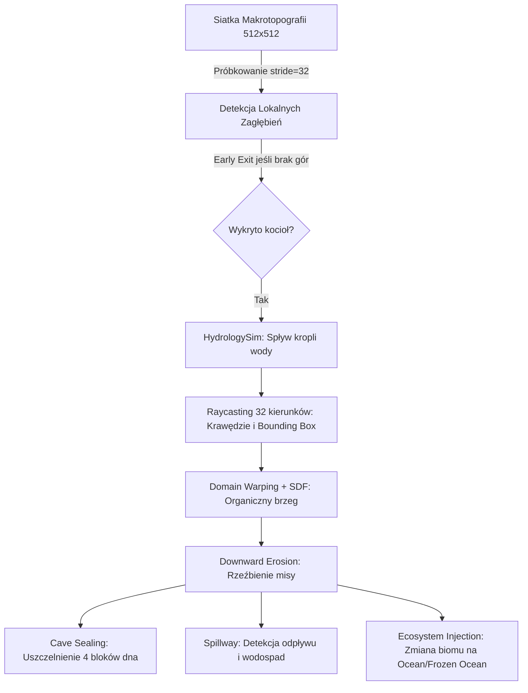
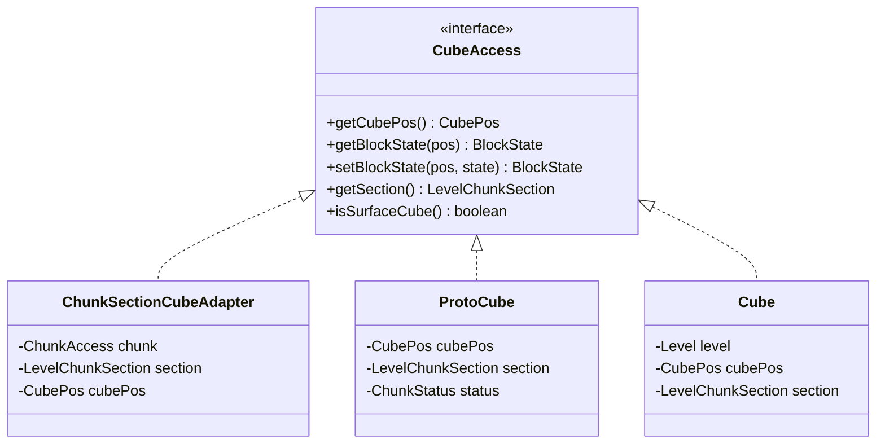

# 🌊 Outflow — Zaawansowany Silnik Hydrologiczny i Geologiczny dla Minecrafta

[](https://fabricmc.net/)
[](https://fabricmc.net/)
[](https://www.oracle.com/java/)
[]()
[](LICENSE_outflow)

> **Outflow** to wysokowydajny mod dla platformy **Fabric (Minecraft 26.2 / Java 25)**, zastępujący waniliowe, nienaturalne generowanie wody realistyczną symulacją hydrologiczną i geomorfologiczną. Mod wprowadza do gry naturalne stawy wysokogórskie (Alpine Tarns), spływy i kaskady wodne (Waterfalls), wulkaniczne kaldery, spękaną krę lodową na jeziorach alpejskich oraz geologiczne urwiska skalne (Cliff Faces) — a wszystko w oparciu o zaawansowane pola odległości (SDF), wielowątkowe algorytmy spływu grawitacyjnego i nowoczesną architekturę podsektorów 3D (Cubic Chunks).

---

## 📑 Spis Treści

1. [Geneza i Wizja Projektu](#-geneza-i-wizja-projektu)
2. [Kluczowe Moduły i Funkcje](#-kluczowe-moduły-i-funkcje)
   - [1. Alpine Tarns (Jeziora Cyrkowe / Stawy Polodowcowe)](#1-alpine-tarns-stawy-wysokogórskie-i-jeziora-cyrkowe)
   - [2. Waterfalls & Cascades (Wodospady i Koryta Spływowe)](#2-waterfalls--cascades-wodospady-i-kaskady-górskie)
   - [3. Calderas & Volcanic Basins (Kaldery Wulkaniczne)](#3-calderas--volcanic-basins-kaldery-wulkaniczne-i-zapadliska)
   - [4. Cliff Face & Steep Slopes (Urwiska Skalne i Gradient Zboczy)](#4-cliff-face--steep-slopes-geologiczne-ściany-skalne)
   - [5. Worley Ice Floes (Realistyczna Kra Lodowa)](#5-worley-ice-floes-popękana-kra-lodowa)
   - [6. Oczyszczanie Zanieczyszczeń Waniliowych](#6-oczyszczanie-zanieczyszczeń-waniliowych)
3. [Architektura Techniczna i Algorytmy](#-architektura-techniczna-i-algorytmy)
   - [Matematyka SDF i Morfologia Terenu](#matematyka-sdf-i-morfologia-terenu)
   - [Symulacja Hydrologiczna (HydrologySim)](#symulacja-hydrologiczna-hydrologysim)
   - [Wielowątkowość i Prefetching (NoiseCache)](#wielowątkowość-i-prefetching-noisecache)
   - [Architektura Wolumetryczna (Cubic Chunks / Sub-chunks 3D)](#architektura-wolumetryczna-cubic-chunks--sub-chunks-3d)
4. [Integracja z Klientem i Interfejs Użytkownika](#-integracja-z-klientem-i-interfejs-użytkownika)
5. [Struktura Projektu i Pakiety](#-struktura-projektu-i-pakiety)
6. [Wymagania i Kompilacja](#-wymagania-i-kompilacja)
7. [Licencja](#-licencja)

---

## 🎯 Geneza i Wizja Projektu

W waniliowym silniku Minecrafta system generowania wody w górach od lat boryka się z rażącymi mankamentami wizualnymi i logicznymi:
* **"Lewitujące" źródła**: Losowe pojedyncze klocki źródła wody (`minecraft:spring_water`) wybijające w środku pionowych ścian i tworzące brzydkie, cienkie strumienie spływające chaotycznie po stokach.
* **Brak prawdziwych jezior górskich**: Woda pojawia się głównie na poziomie morza (Y=63) lub w postaci losowych kałuż na szczytach.
* **Dziurawe dna**: Wodne zbiorniki generujące się nad jaskiniami często przebijają ich stropy, tworząc nieskończone, nienaturalne zacieki do podziemi.
* **Trawiaste pionowe ściany**: Niemożliwie strome, 90-stopniowe urwiska górskie pokryte cienką warstwą trawy lub śniegu zamiast surowej, litej skały.

**Outflow** rozwiązuje te problemy kompleksowo. Wykorzystując rygorystyczne zasady geomorfologii i modelowania matematycznego, mod sprawia, że woda gromadzi się tam, gdzie dyktują to prawa grawitacji — w kotłach lodowcowych, dolinach zawieszonych i misach kraterowych, a jej odpływy tworzą malownicze kaskady spływające po zboczach.

---

## 🏔️ Kluczowe Moduły i Funkcje

### 1. Alpine Tarns (Stawy Wysokogórskie i Jeziora Cyrkowe)
Główny filar moda. Tworzy naturalne zbiorniki wodne u podnóża turni, szczytów i w polodowcowych cyrkach górskich.



* **Zrównoleglone skanowanie regionalne**: Świat podzielony jest na komórki o rozmiarze 512×512 bloków (`gridSize = 512`). Próbkowanie zgrubne (krok 32 bloki) analizuje makrotopografię na wszystkich rdzeniach procesora (`parallelStream`), błyskawicznie odrzucając płaskie niziny.
* **Symulacja spływu kropli (`simulateWaterDrop`)**: Wykryty punkt startowy spływa grawitacyjnie wzdłuż wektorów największego spadku, aż dotrze do rzeczywistego dna kotliny.
* **Raymarching promienisty (32 kierunki)**: Z centrum stawu wyprowadzane są 32 promienie co 11.25°, mierzące odległość do ścian wznoszących się gór lub progu doliny.
* **Domain Warping & Signed Distance Field (SDF)**: Brzegi jeziora nie są idealnymi okręgami czy elipsami. Kształt jest zniekształcany harmonicznymi falami sinusoidalnymi (`Math.sin`, `Math.cos`) oraz szumem brzegowym, tworząc naturalne zatoczki, półwyspy i nieregularne linie brzegowe.
* **Jeziora paciorkowe (Paternoster Lakes & Multi-Lobe)**: Jeśli w jednej dolinie wygenerują się dwa stawy o zbliżonym poziomie zwierciadła wody, zostają one połączone za pomocą wielomianowego gładkiego minimum (`SDFUtils.smin`), tworząc wielokomorowe akweny o wspólnej tafli.
* **Erozja wyłącznie w dół (Downward Erosion)**: Algorytm nigdy nie wznosi sztucznych tam w powietrzu. Jezioro powstaje wyłącznie przez wycinanie przestrzeni w istniejącej masie skalnej.
* **Batymetria i strefy denne (`getLakePaintState`)**:
  * *Płycizna (0-2 bloki głębokości)*: Piasek z domieszką żwiru.
  * *Średnia głębokość (3-6 bloków)*: Żwir, glina (`clay`) oraz kamień.
  * *Głębia (7-12 bloków)*: Zbita glina i kamień.
  * *Otchłań (>12 bloków)*: Lity łupek głębinowy (`deepslate`).
* **Hermetyzacja dna (Cave Sealing)**: Pod dnem jeziora tworzona jest szczelna, 4-blokowa warstwa litego kamienia/ziemi, dzięki czemu woda nie przebija się do podziemnych jaskiń ani nie powoduje spadków FPS przez wycieki.
* **Iniekcja ekosystemu**: Woda stawu otrzymuje odpowiedni biom wodny w kontenerze palety sekcji (`ocean`, `frozen_ocean` lub `lukewarm_ocean` w zależności od temperatury otoczenia). Na płyciznach pojawia się sukcesja roślinna (lilie wodne, trawa morska).
* **Zlodowacenie brzegowe**: W niskich temperaturach (<0.15) tafla wody przy brzegu płynnie zamarza w lód, z جزami szumu lodowego ku środkowi jeziora.

---

### 2. Waterfalls & Cascades (Wodospady i Kaskady Górskie)
Zamiast statycznej tafli, woda w jeziorze górskim znajduje swój naturalny punkt ucieczki.

* **Detekcja progu przelewowego (Spillway)**: Promień o największym spadku terenu poniżej dna basenu wyznacza naturalne koryto odpływowe.
* **Trasowanie strugi wody (Downhill Ray-tracer)**: Woda z przelewu podąża za wektorem największego spadku terenu (do 40 kroków w dół), rzeźbiąc koryto potoku.
* **Trzy typy kaskad**:
  1. `SINGLE_COLUMN`: Wąski potok i wodospad na mniejszych progach skalnych.
  2. `DOUBLE_CASCADE`: Złożony, dwustopniowy wodospad dla spadków terenu powyżej 12 bloków.
  3. `WIDE_CURTAIN`: Szeroka kurtyna wodna dla dużych przelewów.
* **Kotły eworsyjne (Plunge Pools)**: W miejscu uderzenia wodospadu w dno doliny powstaje naturalny kocioł wypełniony wodą, wyłożony mszystym brukiem (`mossy_cobblestone`), kamieniem i żwirem.
* **Ściana tylna i oczyszczanie czoła**: Generator dba o to, by wodospad spływał po litej skale, automatycznie uzupełniając ubytki w ścianie za strugą i oczyszczając przestrzeń z przodu.

---

### 3. Calderas & Volcanic Basins (Kaldery Wulkaniczne i Zapadliska)
Monumentalne formacje wulkaniczne o promieniu 35–60 bloków.

* **Dwa typy genezy**:
  * *Zapadlisko szczytowe (Peak Collapse)*: Wierzchołek wysokiej góry ulega gwałtownemu zapadnięciu o 30–70 bloków w głąb masywu.
  * *Kocioł kraterowy (Basin Crater)*: Szeroki amfiteatr skalny otoczony wieńcem stromych ścian.
* **Dynamika wypełnienia**: 60% kalder jest wypełnionych wodą (częściowo lub całkowicie), tworząc lazurowe jeziora kraterowe; 40% to suche, surowe kotły wulkaniczne.
* **Wulkaniczna geologia dna**:
  * Ściany i płycizny: tuf (`tuff`) oraz bazalt (`basalt`).
  * Głębsze strefy: gładki bazalt (`smooth_basalt`).
  * Strefa gorąca (7–12 bloków głębokości): bloki magmy (`magma_block`).
  * Dno komory magmowej: lity obsydian (`obsidian`).
* **Wzmocnione ryglowanie jaskiń**: Dno kaldery wierci w głąb gruntu aż do napotkania 3 kolejnych litych bloków (do 20 bloków wgłąb), gwarantując brak wycieków magmy i wody do podziemnych pieczar.

---

### 4. Cliff Face & Steep Slopes (Geologiczne Ściany Skalne)
Koniec z zieloną trawą rosnącą na pionowych, 90-stopniowych przepaściach.

* **Euklidesowy gradient nachylenia**: Mod oblicza rzeczywisty gradient wektorowy powierzchni:
  $$\text{Gradient} = \sqrt{\left(\frac{\Delta h_x}{\Delta x}\right)^2 + \left(\frac{\Delta h_z}{\Delta z}\right)^2}$$
* **Próg stromizny (`STEEP_THRESHOLD = 4`)**: Jeśli spadek terenu na dystansie 2 bloków wynosi co najmniej 2.0 (czyli 4 bloki w pionie), teren kwalifikowany jest jako urwisko.
* **Zdzieranie humusu (`stripTopsoil`)**: Miękka pokrywa powierzchniowa (trawa, ziemia, podzol, śnieg) jest bezwzględnie usuwana na głębokość do 8 bloków (`STRIP_DEPTH`).
* **Lita skała pod spodem**: Odsłonięta ściana otrzymuje naturalny kamień (`stone`) powyżej Y=0 lub łupek głębinowy (`deepslate`) w strefie ujemnych wysokości.
* **Optymalizacja buforowa**: Wysokości 16×16 w obrębie chunka są obliczane jednokrotnie do tablicy `heights[][]`, co eliminuje wielokrotne, kosztowne zapytania o wysokość.

---

### 5. Worley Ice Floes (Popękana Kra Lodowa)
W chłodnych biomach duże jeziora nie są płaską, nudną płytą lodową.

* **Szum komórkowy Worleya (Cellular/Voronoi)**: Tafla jeziora dzielona jest na wielokątne komórki kry (`CELL_SIZE = 6`) przy użyciu deterministycznego haszowania 64-bitowego z seeda świata.
* **Naturalne szczeliny wodne (`CRACK_WIDTH = 0.16`)**: Krawędzie między komórkami Worleya są roztapiane i zastępowane otwartą wodą, tworząc wrażenie dryfującej, połamanej kry.
* **Pas ochronny brzegu (`SHORE_MARGIN = 3`)**: Zewnętrzny pierścień lodu przylegający do lądu pozostaje nienaruszony — kra pęka wyłącznie na otwartej głębi.

---

### 6. Oczyszczanie Zanieczyszczeń Waniliowych
W klasie `OutflowWorldGen`:
* **Usunięcie `minecraft:spring_water`**: Za pośrednictwem `BiomeModifications` z fazą `REPLACEMENTS`, mod usuwa ze wszystkich biomów oznaczonych tagiem `#minecraft:is_mountain` waniliowe źródła wody wybijające w ścianach, pozostawiając góry czyste dla realistycznych kaskad Outflow.

---

## ⚙️ Architektura Techniczna i Algorytmy

### Matematyka SDF i Morfologia Terenu
Klasa [`SDFUtils`](src/main/java/pl/k8bus/outflow/worldgen/math/SDFUtils.java) zawiera rdzenne funkcje modelowania kształtów:

| Funkcja | Równanie matematyczne | Zastosowanie |
|---|---|---|
| `smoothstep(e0, e1, x)` | $t = \text{clamp}\left(\frac{x-e0}{e1-e0}, 0, 1\right); \quad 3t^2 - 2t^3$ | Płynne, nieliniowe przejścia zboczy i brzegów |
| `sdfCircle(dx, dz, r)` | $\sqrt{\Delta x^2 + \Delta z^2} - r$ | Płaskie pole odległości bazy misy jeziora |
| `smin(a, b, k)` | $h = \max(k - \vert a-b \vert, 0)/k; \quad \min(a, b) - \frac{1}{4} h^2 k$ | Wielomianowe stapianie wielu zbiorników wodnych w jeden |
| `sdfMeanderingRiver(...)` | $\vert \Delta z - A \cdot \sin(\Delta x \cdot f) \vert - w$ | Matematyczny profil meandrującego koryta rzeki |

---

### Symulacja Hydrologiczna (HydrologySim)
Klasa [`HydrologySim`](src/main/java/pl/k8bus/outflow/worldgen/math/HydrologySim.java) wykonuje fizyczną symulację zbieżności cieków wodnych:
1. **Faza 1 (Makro)**: Krok próbkowania = 16 bloków (6 iteracji w 8 kierunkach). Szybkie zbieganie w dół doliny.
2. **Faza 2 (Mezo)**: Krok próbkowania = 8 bloków (5 iteracji w 8 kierunkach). Wprowadzanie do zagłębienia.
3. **Faza 3 (Mikro)**: Krok próbkowania = 4 bloki (3 iteracje w 4 kierunkach). Precyzyjne odnalezienie lokalnego minimum (dna niecki).
4. **Walidacja niecki (`isValidBasin`)**: Sprawdza, czy punkt nie jest dnem zbyt wąskiego, nienaturalnego wąwozu (wymagany otwarty profil z co najmniej 4 stron).

---

### Wielowątkowość i Prefetching (NoiseCache)
Generowanie zaawansowanej topografii wymaga intensywnego próbkowania generatora hałasu Minecrafta. Aby zachować płynność gry (60+ FPS / 20 TPS):
* **Pula wątków `ForkJoinPool.commonPool()`**: Obliczenia siatki jezior wykonywane są asynchronicznie za pośrednictwem `CompletableFuture`.
* **Proaktywny prefetching (`AlpineTarnLocator.prefetchNeighbors`)**: Gdy gracz zbliża się do granicy sektora, Outflow natychmiast zleca w tle analizę topograficzną dla sąsiednich kratek (Północ, Południe, Wschód, Zachód). Gdy chunk wkracza w fazę dekoracji, dane o jeziorach są już gotowe w pamięci RAM.
* **Pamięć podręczna wysokości (`HEIGHT_CACHE`)**: Szybki cache `ConcurrentHashMap<Long, Integer>` przechowujący do 65 536 próbek wysokości terenu, zapobiegający powtarzaniu tych samych kalkulacji `getBaseHeight`.

---

### Architektura Wolumetryczna (Cubic Chunks / Sub-chunks 3D)
Pakiet `pl.k8bus.outflow.cubic` to nowoczesna baza pod w pełni trójwymiarowe zarządzanie przestrzenią świata:



* **`CubePos`**: 64-bitowa kompresja pozycji kostki 16×16×16 (`asLong()`, `fromLong()`) z podziałem: 22 bity X, 20 bitów Y, 22 bity Z.
* **`ChunkSectionCubeAdapter`**: Most pozwalający traktować standardowe sekcje Minecrafta jako niezależne sześciany 3D.
* **Oznaczanie sekcji powierzchni (`SurfaceSection` & `LevelChunkSectionMixin`)**: `NoiseBasedChunkGeneratorMixin` oznacza sekcje zawierające faktyczną powierzchnię świata oraz sekcję bezpośrednio pod nią. Pozwala to na natychmiastowe pomijanie pustych sekcji powietrza i jednolitej skały podziemnej, drastycznie przyspieszając skanowanie świata.

---

## 🖥️ Integracja z Klientem i Interfejs Użytkownika

Podczas tworzenia nowego świata lub wczytywania wymiaru, Outflow informuje gracza o stanie prac silnika hydrologicznego na ekranie ładowania ([`LevelLoadingScreenMixin`](src/client/java/pl/k8bus/client/mixin/LevelLoadingScreenMixin.java)):

* **Dynamiczny wskaźnik postępu**:
  $$\text{Tytuł: } \text{\color{#66CCFF}Alpine Tarns Waterworks [X tasks]}$$
* **Animowany kolor wody**: Tytuł mieni się płynną, błękitno-turkusową falą RGB zależną od czasu systemowego:
  $$R = 60 + 20\sin\left(\frac{t}{200}\right), \quad G = 180 + 30\sin\left(\frac{t}{250} + 1\right), \quad B = 230 + 20\sin\left(\frac{t}{300} + 2\right)$$
* **Aktualny stan przetwarzania**:
  * `>> Scanning regional topography... <<`
  * `>> Simulating fluid raycasts... <<`
  * `>> Validating basin constraints... <<`

---

## 📂 Struktura Projektu i Pakiety

```text
pl.k8bus/
├── outflow/
│   ├── Outflow.java                      # Główny ModInitializer Fabric
│   ├── cubic/                            # Podsystem silnika wolumetrycznego (3D Sub-chunks)
│   │   ├── math/
│   │   │   └── CubePos.java              # 64-bitowa reprezentacja pozycji kostki 16x16x16
│   │   └── world/
│   │       ├── CubeAccess.java           # Interfejs dostępu do kostki 3D
│   │       ├── ChunkSectionCubeAdapter.java # Adapter: 2D LevelChunkSection -> 3D CubeAccess
│   │       ├── ProtoCube.java            # Kostka w fazie generowania
│   │       ├── Cube.java                 # Załadowana kostka w świecie gry
│   │       └── SurfaceSection.java       # Interfejs oznaczania sekcji powierzchniowej
│   ├── mixin/                            # Wstrzyknięcia do silnika waniliowego
│   │   ├── CarvingContextMixin.java      # Dostęp do generatora w jaskiniach
│   │   ├── LazyXZConditionAccessor.java  # Akcesor do kontekstu SurfaceRules
│   │   ├── LevelChunkSectionMixin.java   # Implementacja SurfaceSection
│   │   ├── NoiseBasedChunkGeneratorMixin.java # Oznaczanie sekcji powierzchniowych po buildSurface
│   │   └── SteepSlopeMixin.java          # Zastąpienie waniliowej detekcji stromizny
│   ├── registry/
│   │   ├── CarvingContextAccessor.java   # Interfejs akcesora generatora
│   │   └── OutflowWorldGen.java          # Rejestracja Feature'ów i BiomeModifications
│   └── worldgen/
│       ├── feature/                      # Cechy generowania świata (Features)
│       │   ├── AlpineTarnFeature.java    # Cecha stawów alpejskich
│       │   ├── CliffFaceFeature.java     # Cecha geologicznych urwisk
│       │   ├── CliffFacePhase.java       # Algorytm zdzierania humusu ze stromizn
│       │   ├── GlacierLakeFeature.java   # Eksperymentalne laguny i języki lodowców
│       │   ├── IceFloeFeature.java       # Cecha kry lodowej
│       │   ├── IceFloePhase.java         # Szum Worleya i szczeliny w lodzie
│       │   ├── WaterfallFeature.java     # Trasowanie kaskad, spływów i kotłów eworsyjnych
│       │   ├── caldera/                  # Podsystem kalder wulkanicznych
│       │   │   ├── CalderaBuilder.java   # Budowanie misy wulkanicznej i uszczelnianie
│       │   │   ├── CalderaFeature.java   # Cecha kaldery
│       │   │   └── CalderaLocator.java   # Wyszukiwanie zapadlisk i kraterów
│       │   ├── lake/                     # Struktury danych jezior
│       │   │   ├── LakeCacheKey.java     # Klucz haszujący komórkę siatki
│       │   │   └── LakeCenterData.java   # Model danych stawu (promień, poziom wody, przelew)
│       │   └── tarn/                     # Podsystem stawów cyrkowych
│       │       ├── AlpineTarnBuilder.java# Formowanie stawu, batymetria, SDF, uszczelnianie dna
│       │       └── AlpineTarnLocator.java# Skanowanie makrotopografii, raymarching, prefetching
│       └── math/                         # Narzędzia matematyczne
│           ├── HydrologySim.java         # Symulacja grawitacyjnego spływu wody
│           ├── NoiseCache.java           # Wielowątkowa pamięć podręczna i prefetching
│           └── SDFUtils.java             # Pola odległości (SDF), smoothstep, smin, meandry
└── client/
    ├── OutflowClient.java                # ClientModInitializer Fabric
    ├── OutflowDataGenerator.java         # Generator danych Fabric DataGen
    └── mixin/
        └── LevelLoadingScreenMixin.java  # Wskaźnik "Waterworks" na ekranie ładowania
```

---

## 🛠️ Wymagania i Kompilacja

### Wymagania Środowiskowe
* **Minecraft**: `26.2`
* **Java Development Kit (JDK)**: `Java 25` lub nowsza
* **Fabric Loader**: `>= 0.19.3`
* **Fabric API**: `0.154.2+26.2`

### Budowanie ze Źródeł (Gradle)

Aby skompilować plik `.jar` modyfikacji, wykonaj w katalogu głównym:

```bash
# Windows
gradlew.bat build

# Linux / macOS
./gradlew build
```

Skompilowany plik moda znajdziesz w folderze:
```text
build/libs/outflow-0.0.1-Alpha.6.jar
```

---

## 📄 Licencja

Projekt objęty jest licencją **Creative Commons Zero v1.0 Universal (CC0 1.0)** — patrz plik [LICENSE_outflow](LICENSE_outflow). Kod jest wolny do użytku, modyfikacji, dystrybucji i włączania do paczek modów (modpacków).
